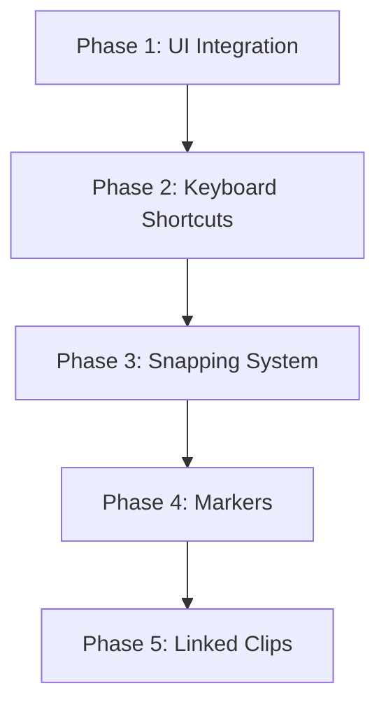

# UI Integration & Advanced Features Implementation Plan

## Overview

This plan covers 5 major features to be implemented step-by-step, building upon the existing editing commands ([RippleDeleteCommand](file:///e:/projectstrawberry/crates/strawberry-core/src/commands/timeline.rs#1299-1314), [SlipClipCommand](file:///e:/projectstrawberry/crates/strawberry-core/src/commands/timeline.rs#1488-1501), [SlideClipCommand](file:///e:/projectstrawberry/crates/strawberry-core/src/commands/timeline.rs#1713-1738), [RazorToolCommand](file:///e:/projectstrawberry/crates/strawberry-core/src/commands/timeline.rs#2053-2065)).

---

## Phase 1: UI Integration for Editing Commands

### Research Reference

> [!IMPORTANT]
> Before implementation, study these research files:
> - [pointer.h](file:///e:/projectstrawberry/research/timelinewidget/tool/pointer.h) - Movement modes, trim handles, rubberband selection
> - [pointer.cpp](file:///e:/projectstrawberry/research/timelinewidget/tool/pointer.cpp) - Drag initialization, ghost items, ProcessDrag pattern
> - [tool.h](file:///e:/projectstrawberry/research/tool.h) - ValidateTimeMovement, ValidateTrackMovement patterns

### Proposed Changes

#### [MODIFY] [timeline.rs](file:///e:/projectstrawberry/crates/strawberry-ui/src/widgets/timeline.rs)

Add new tool mode enum and state:

```rust
/// Active editing tool mode (like Olive's TimelineTool subclasses)
#[derive(Debug, Clone, Copy, PartialEq, Eq, Default)]
pub enum TimelineTool {
    #[default]
    Pointer,    // Default: select, move, trim
    Razor,      // Split at click position
    Slip,       // Modifier: shift source content
    Slide,      // Modifier: move clip adjusting neighbors
}

/// Add to TimelineWidget:
pub struct TimelineWidget {
    // ... existing fields ...
    active_tool: TimelineTool,
    slip_drag_state: Option<SlipDragState>,
    slide_drag_state: Option<SlideDragState>,
}
```

**UI Elements to Add:**
1. Tool mode buttons in timeline header (or floating toolbar)
2. Razor cursor when in Razor mode
3. Slip/Slide visual feedback during drag

**Keyboard Shortcuts (Phase 1):**
| Key | Action |
|-----|--------|
| `Shift+Delete` | Ripple delete selected clip |
| `B` | Toggle Razor tool |
| `V` | Switch to Pointer tool |

---

## Phase 2: Keyboard Shortcuts System

### Research Reference

> [!NOTE]
> Olive uses Qt's built-in shortcut system. We build a custom ECS-based system.

#### [NEW] [keyboard.rs](file:///e:/projectstrawberry/crates/strawberry-core/src/keyboard.rs)

```rust
/// Keyboard shortcut registry stored as ECS Resource
pub struct KeyboardShortcuts {
    bindings: HashMap<KeyCombination, ShortcutAction>,
}

#[derive(Hash, Eq, PartialEq)]
pub struct KeyCombination {
    key: egui::Key,
    modifiers: Modifiers,
}

pub enum ShortcutAction {
    Command(Box<dyn Fn() -> Box<dyn Command>>),
    ToolSwitch(TimelineTool),
    Custom(fn(&mut World)),
}
```

**Default Shortcuts:**
| Key | Action |
|-----|--------|
| `Ctrl+Z` | Undo |
| `Ctrl+Shift+Z` | Redo |
| [Delete](file:///e:/projectstrawberry/crates/strawberry-core/src/commands/timeline.rs#730-742) | Delete selected clips |
| `Shift+Delete` | Ripple delete |
| `S` | Split at playhead |
| `B` | Razor tool |
| `V` | Pointer tool |
| `M` | Add marker at playhead |

---

## Phase 3: Snapping System

### Research Reference

> [!IMPORTANT]
> Study these files:
> - [tool.cpp](file:///e:/projectstrawberry/research/tool.cpp#L62-L72) - [SnapMovementToTimebase](file:///e:/projectstrawberry/research/tool.cpp#62-73) function
> - [pointer.cpp](file:///e:/projectstrawberry/research/timelinewidget/tool/pointer.cpp) - Ghost snapping during drag

#### [NEW] [snapping.rs](file:///e:/projectstrawberry/crates/strawberry-core/src/systems/snapping.rs)

```rust
/// Snap target types
pub enum SnapTarget {
    Playhead,
    ClipEdge(Entity),
    Marker(Entity),
    FrameBoundary,
}

/// Snapping configuration resource
#[derive(Resource)]
pub struct SnappingConfig {
    pub enabled: bool,
    pub snap_to_playhead: bool,
    pub snap_to_clips: bool,
    pub snap_to_markers: bool,
    pub snap_to_frames: bool,
    pub snap_threshold_px: f32, // Default: 10px
}

/// Snap result
pub struct SnapResult {
    pub snapped_time: Duration,
    pub target: Option<SnapTarget>,
    pub did_snap: bool,
}

/// Core snapping function
pub fn find_snap_point(
    time: Duration,
    threshold: Duration,
    playhead: Duration,
    clip_edges: &[Duration],
    markers: &[Duration],
    frame_rate: &FrameRate,
    config: &SnappingConfig,
) -> SnapResult;
```

#### [MODIFY] [timeline.rs](file:///e:/projectstrawberry/crates/strawberry-ui/src/widgets/timeline.rs)

- During [ClipDragState](file:///e:/projectstrawberry/crates/strawberry-ui/src/widgets/timeline.rs#172-188) processing, call `find_snap_point()`
- Draw snap indicator line when snapped
- Play subtle audio/visual feedback on snap

---

## Phase 4: Markers & Labels

### Research Reference

> [!IMPORTANT]
> Study:
> - [timelinemarker.h](file:///e:/projectstrawberry/research/timeline/timelinemarker.h) - TimelineMarker, TimelineMarkerList, MarkerAddCommand
> - [timelinemarker.cpp](file:///e:/projectstrawberry/research/timeline/timelinemarker.cpp) - GetClosestMarkerToTime, draw logic

#### [NEW] [markers.rs](file:///e:/projectstrawberry/crates/strawberry-core/src/components/markers.rs)

```rust
/// Timeline marker component
#[derive(Component, Debug, Clone, Serialize, Deserialize)]
pub struct TimelineMarker {
    pub name: String,
    pub time: Duration,
    pub color: [u8; 4],
    pub marker_type: MarkerType,
}

#[derive(Debug, Clone, Copy, Serialize, Deserialize)]
pub enum MarkerType {
    Standard,
    Chapter,
    Comment,
    ToDo,
}
```

#### [NEW] Commands

```rust
pub struct AddMarkerCommand { timeline: u64, time: f64, name: String, color: [u8; 4] }
pub struct RemoveMarkerCommand { marker: u64 }
pub struct MoveMarkerCommand { marker: u64, new_time: f64 }
pub struct RenameMarkerCommand { marker: u64, new_name: String }
```

#### [MODIFY] [timeline.rs](file:///e:/projectstrawberry/crates/strawberry-ui/src/widgets/timeline.rs)

- Render markers in ruler area (triangles/flags)
- Double-click marker to rename
- Right-click context menu for marker operations
- Drag markers to reposition

---

## Phase 5: Linked Clips / Grouped Selection

### Research Reference

> [!NOTE]
> Kdenlive uses GroupsModel for linked clips. We use a simpler ECS approach.

#### [NEW] [groups.rs](file:///e:/projectstrawberry/crates/strawberry-core/src/components/groups.rs)

```rust
/// Clip group component - clips in same group move/delete together
#[derive(Component, Debug, Clone, Serialize, Deserialize)]
pub struct ClipGroup {
    pub group_id: u64,
}

/// Group metadata
#[derive(Component, Debug, Clone)]
pub struct GroupMetadata {
    pub name: String,
    pub locked: bool,
}
```

#### [NEW] Commands

```rust
pub struct GroupClipsCommand { clips: Vec<u64> }
pub struct UngroupClipsCommand { group: u64 }
pub struct LinkAudioVideoCommand { video_clip: u64, audio_clip: u64 }
pub struct UnlinkClipsCommand { clips: Vec<u64> }
```

**Behavior:**
- When a grouped clip is selected, all group members are selected
- Move/delete operations affect all grouped clips
- Ctrl+G to group, Ctrl+Shift+G to ungroup

---

## Implementation Order



## Verification Plan

### Per-Phase Tests

| Phase | Tests |
|-------|-------|
| 1 | Tool switching, razor cut at position, Shift+Delete ripple |
| 2 | Shortcut registration, conflict detection, custom bindings |
| 3 | Snap to playhead, snap to clip edge, snap threshold |
| 4 | Add/remove/move markers, marker persistence |
| 5 | Group/ungroup, linked selection, group operations |

### Manual Verification

```bash
cargo run -p strawberry-app
```
- Verify tool buttons work
- Test keyboard shortcuts
- Confirm snapping visual feedback
- Check marker rendering in ruler

---

## Estimated Effort

| Phase | Complexity | Est. LOC |
|-------|------------|----------|
| 1 - UI Integration | Medium | ~400 |
| 2 - Keyboard Shortcuts | Low | ~200 |
| 3 - Snapping | Medium | ~300 |
| 4 - Markers | Medium | ~400 |
| 5 - Linked Clips | High | ~500 |

**Total: ~1800 LOC across 5 phases**
